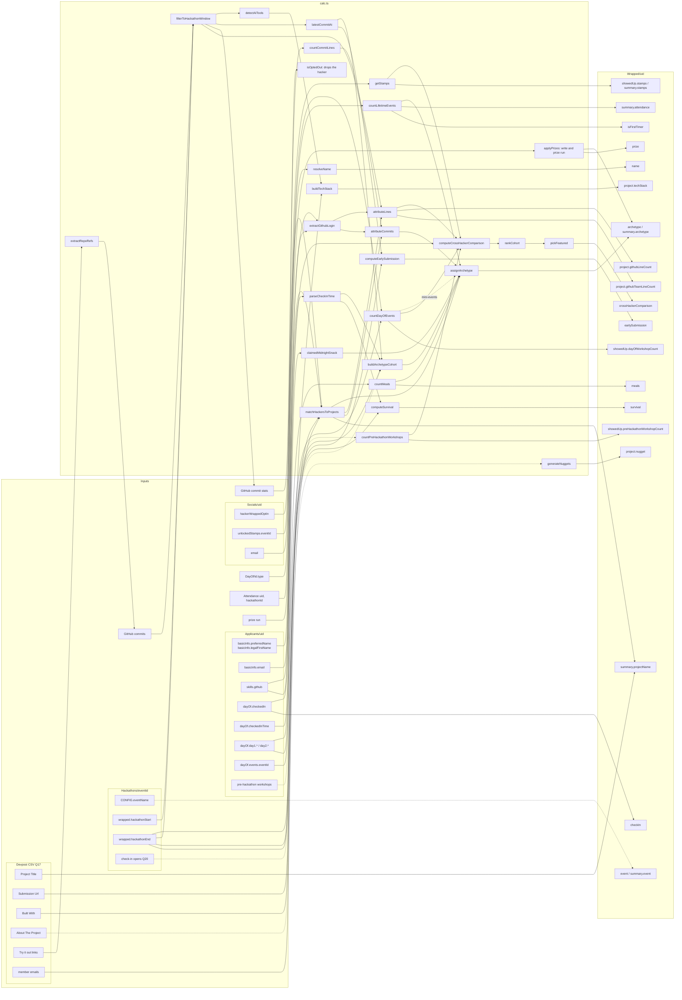

# Hacker Wrapped script

> Anything marked **Q*n*** is an open question (listed at
> the end) and is also marked `TODO(Qn)` in the code. Settled answers are under
> [Decisions](#decisions).

Builds one `Hackathons/{eventId}/Wrapped/{uid}` doc per attending, opted-in hacker from
Firestore, the Devpost CSV export and GitHub.

## Running

```sh
pnpm wrapped write                  # resume where the last run stopped
pnpm wrapped write --from enrich    # redo enrich and every stage after it
pnpm wrapped write --from write     # rewrite every doc from the last assemble
pnpm wrapped prize | stats | delete
```

Set these at the top of `script.ts` before each run:

| Field              | Meaning                                                         |
| ------------------ | --------------------------------------------------------------- |
| `eventId`          | Doc id under `Hackathons/`, e.g. `hackcamp2026`                 |
| `env`              | `dev` or `prod`; picks the service-account credential           |
| `writeToFirestore` | Off: the run stops after writing `output/docs.json` locally     |
| `bypassCache`      | On: re-fetch every source instead of reading `raw/`             |
| `devpostCsvPath`   | Path to the Devpost export                                      |
| `nuggetLimit`      | Cap on Nugget messages in total, to try the prompt first; `null` on the real run |

`.env`: `FIREBASE_SERVICE_ACCOUNT`, `DEV_FIREBASE_SERVICE_ACCOUNT` (JSON inline or a file
path), `GITHUB_PAT`, `ANTHROPIC_API_KEY` (only when a Nugget message needs generating); for
`prize`, `VITE_PUBLIC_SUPABASE_URL` and `SUPABASE_SECRET_KEY`.

## Modes

| Mode     | Does                                                                  |
| -------- | --------------------------------------------------------------------- |
| `write`  | The five stages below                                                 |
| `prize`  | Adds `prize` to existing docs after judging; see [Prize run](#prize-run) |
| `stats`  | Organizer statistics: WrappedStats/{uid} -> WrappedStats/Summary      |
| `delete` | Deletes `Hackathons/{eventId}/Wrapped/*` after a typed confirmation; with `writeToFirestore` off it only counts them |

## Write run

```
fetch ──> match ──> enrich ──> assemble ──> write
          ▲         ▲          ▲
          └─────────┴──────────┴── checkpoints (--from)
```

| # | Stage      | Reads                        | Produces                                  | UI                                   |
| - | ---------- | ---------------------------- | ----------------------------------------- | ------------------------------------ |
| 1 | `fetch`    | Firestore, Devpost CSV       | `Hacker[]` (opted-out dropped), rows, event | bar per source; "x hackers recorded" |
| 2 | `match`    | stage 1, `overrides.json`    | `Project[]`, uid → project                | report, then **pauses** for review   |
| 3 | `enrich`   | stages 1–2, GitHub, Anthropic | per-project commit and line counts, AI tools, Nugget | bar per project, rate-limit check, bar per commit, then **pauses** for Nugget review |
| 4 | `assemble` | stages 1–3                   | `WrappedDoc` per hacker                   | null count per field, featured split |
| 5 | `write`    | stage 4                      | Firestore docs                            | bar per batch; confirm on prod       |

### Per-item loops and cohort-wide steps

Anything that compares hackers to each other runs once over the whole cohort, never
inside a loop.

| Stage      | Per item                                                                                   | Cohort-wide (once)                                                     |
| ---------- | ------------------------------------------------------------------------------------------ | ---------------------------------------------------------------------- |
| `fetch`    | `buildHacker` per applicant                                                                | the Attendance scan (one query, then lookups); the opt-out filter      |
| `match`    | none                                                                                       | `matchHackersToProjects` over every row and hacker                     |
| `enrich`   | per project: fetch commits, window filter. Per commit: fetch stats, `countCommitLines`. Per project: `attributeCommits`, `attributeLines`, `detectAiTools` | between the loops: one rate-limit check. After them: commit quartile, one Nugget batch, then the review pause |
| `assemble` | per hacker: `assignArchetype`, `buildWrappedDoc`                                           | before the loop: `buildArchetypeCohort`, then `computeCrossHackerComparison` (`rankCohort` over three cohorts) |

### Checkpoints

Resume points, and why each one is at a boundary worth stopping on:

1. **`match`**: every Firestore read and the CSV parse are done. Redo from here after
   editing `overrides.json` or changing matching rules. No network.
2. **`enrich`**: matching has been reviewed and accepted. Redo from here after changing
   commit attribution, line counting (`LINE_COUNT_EXCLUSIONS`), the window or AI
   detection. Commit lists are cached per repo, commit stats per sha, and Nugget messages
   per project (`nuggets.json`, reused while their inputs match), so this redoes the work
   without re-fetching. Commits are fetched from a week before `hackathonStart`, so
   moving the window earlier than that needs `bypassCache` (or deleting `raw/github/`).
3. **`assemble`**: every per-project value exists. Redo from here after changing a
   formula, the archetype rules, the comparison's threshold, cohorts or priority, or the
   output schema. Takes seconds.

`write` resumes by itself: `progress.json` records the uids already committed.
`--from write` clears that list to rewrite every doc. `--from fetch` reruns everything
but still reads `raw/` unless `bypassCache` is on.

`stages/enrich.json` and `stages/assemble.json` carry `schemaVersion`
(`STAGE_SCHEMA_VERSION` in `types.ts`; absent means 1). Bump it when either shape
changes. `assemble` refuses an older enrich ("run --from enrich"), and `write` refuses
an older assemble ("run --from assemble") even on a plain resume, which would otherwise
push old-shape docs.

### Failure recovery

- **Lines committed (schema 2):** rerun `--from enrich`. Commit lists come from
  `raw/github/`; only the per-commit stats are new requests, one per in-window commit
  (about 1,340 for cmd-f2026).
- **Before the stats loop**, enrich compares the uncached count with `GET /rate_limit`
  and, if it's short, asks to continue or abort.
- **Interrupted enrich** (Ctrl-C, crash): loses at most the 6 requests in flight. Stats
  are cached per sha and kept with `bypassCache` on, so the rerun picks up where it
  stopped.
- **Rate limit mid-run:** the run stops with the reset time. Rerun after the reset; it
  resumes from the cache.

### Progress file

`cache/{env}/{eventId}/progress.json`, written at every stage change and (throttled)
during a stage's progress bar:

```json
{
  "eventId": "hackcamp2026",
  "env": "dev",
  "updatedAt": "2026-09-28T19:02:11.000Z",
  "stages": {
    "fetch":    { "status": "done", "startedAt": "…", "finishedAt": "…" },
    "match":    { "status": "done", "startedAt": "…", "finishedAt": "…" },
    "enrich":   { "status": "running", "done": 41, "total": 120 },
    "assemble": { "status": "pending" },
    "write":    { "status": "pending" }
  },
  "writtenUids": []
}
```

With no `--from`, a run starts at the first stage not marked `done`. `--from X` resets X,
every later stage and the ledger to `pending` first. With `writeToFirestore` off, `write`
is marked `skipped`, so turning it on and rerunning goes straight to `write`.

### Cache layout

Keyed by env as well as event, so a dev run never reuses prod data.

```
cache/{env}/{eventId}/
  raw/
    event.json  applicants.json  socials.json  dayof.json  attendance.json
    stamps.json  prehackathon-workshops.json
    awards.json                      prize run: judging-portal award placements
    github/{owner}__{repo}.json      one per repo; null if private or missing
    github-commits/{sha}.json        one per counted commit: parents and per-file additions;
                                     null if unreadable; kept with bypassCache (a sha never changes)
  stages/{fetch,match,enrich,assemble}.json
  overrides.json                     hand-written match fixes; never overwritten
  nuggets.json                       Nugget messages + review state; ignores bypassCache
  nugget-batch.json                  only while a Message Batch is in flight
  match-report.json
  output/docs.json  output/nugget-review.json  output/prizes.json  output/stats.json
  progress.json
```

`raw/socials.json` holds opt-in flags, so a hacker who opts out after the first fetch is
only picked up with `bypassCache` on.

### Opt-out

After `Socials/{uid}` is fetched, hackers with `hackerWrappedOptIn === false` are
dropped. A missing field or a missing Socials doc means included. Opted-out hackers get
no doc, aren't in any cohort figure, and have their emails kept only so the match report
doesn't list them as unmatched. Their commits and lines still count toward their team's
total. Because they leave every cohort, an opt-out also moves other hackers'
`crossHackerComparison` percentiles (and possibly their `featured` stat), not only their
own doc, so picking one up means rewriting every doc, not just deleting theirs.

### Match review pause

`match` prints the report and waits:

- **c**: accept and continue
- **r**: re-read `overrides.json` and match again
- **a**: abort (progress stays at `match`)

The report lists: matched hackers, hackers with no project, rows no one matched,
unmatched emails on matched rows, and hackers found on more than one row. The terminal
shows the first 10 of each list; `match-report.json` has all of them. Override entries
naming an unknown uid, email or submission URL are printed as warnings.

`overrides.json`:

```json
{
  "emailToUid": { "alt.email@gmail.com": "<uid>" },
  "uidToProject": { "<uid>": "<submission url>", "<uid2>": null }
}
```

### Nugget review pause

After the GitHub loop, enrich generates the missing Nugget messages in one Message Batch
and, if any message is unreviewed, writes `output/nugget-review.json` and waits:
**c** accepts the file's edits (checked against the message rules) and marks every message
reviewed, **s** (dev only) continues without review, **a** aborts. A blank message hides the
slide. Details in [NUGGET.md](NUGGET.md).

### Writing

Every doc is fully rewritten (`set` without merge), so fields dropped from the schema
disappear. The one exception is `prize`: each batch first reads the existing docs'
`prize` and carries it into the new doc, so re-running `write` after the prize run keeps
prizes.

### Prize run

`prize` reads every `award_placement` for the event from the judging portal (Supabase).
The event is the portal `hackathon` row whose name + year equals `eventId` with
non-alphanumerics dropped, e.g. `{cmd-f, 2026}` for `cmd-f2026`. Awards are joined to
the match stage's projects by Devpost slug (`/software/icarus` and
`/submissions/961463-icarus` both give `icarus`), so the CSV and the portal can use
different URL forms. Every member of a winning project gets `applyPrizes` with the
project's award names.

The run prints the winners and any prizewinning project that matches no CSV row with a
matched hacker (those prizes reach no doc), and writes `output/prizes.json`. With
`writeToFirestore` on, it rewrites each winner's existing doc; winners with no doc are
listed, so run `write` first. Rerunning is safe because `applyPrizes` dedupes. Set
`bypassCache` to pick up awards changed in the portal since the last run.

Every placement the portal records counts as a prize, 4th included (cmd-f2026 has a 4th
place in "Top Three Finalists", "nwChoice Award" and "UBC CS Project Hub").

## Field graph

Source fields on the left, calculation functions (in `calc.ts`) in the middle, doc
fields on the right. Dashed lines mean an unresolved question.



### Field table

| Output field                         | Calculation                                        | Inputs                                                             | Null / default                          |
| ------------------------------------ | -------------------------------------------------- | ------------------------------------------------------------------ | --------------------------------------- |
| `event`, `summary.event`             | none                                               | `CONFIG.eventName`                                                 | none                                    |
| `eventId`                            | none                                               | `CONFIG.eventId`                                                   | none                                    |
| `generatedAt`                        | none                                               | run clock                                                          | none                                    |
| `name`                               | `resolveName`                                      | `basicInfo.preferredName` → `legalFirstName` → `"Hacker"`          | `"Hacker"`                              |
| `isFirstTimer`                       | `countLifetimeEvents`                              | `Attendance` (uid, hackathonId); excludes this event               | `count == 0`                            |
| `summary.attendance`                 | `countLifetimeEvents` + 1                          | `Attendance`; excludes this event                                  | `1`                                     |
| `checkIn`                            | none                                               | `dayOf.checkedIn === true`                                         | `false`                                 |
| `survival`                           | `parseCheckInTime`, `computeSurvival`              | `wrapped.hackathonEnd` − `dayOf.checkedInTime`                     | null if not checked in                  |
| `earlySubmission`                    | `latestCommitAt`, `computeEarlySubmission`         | `wrapped.hackathonEnd` − project's latest in-window commit         | null with no project or no commits      |
| `meals`                              | `countMeals`                                         | `dayOf.day1.*`, `dayOf.day2.*`                                     | `0` (**Q18**)                           |
| `showedUp.dayOfWorkshopCount`        | `countDayOfEvents(…, "workshops")`                 | `dayOf.events[].eventId` ⋈ `DayOf/{id}.type`                       | `0`                                     |
| `showedUp.preHackathonWorkshopCount` | `countPreHackathonWorkshops`                       | `preDayOf.events` ∩ `PreHackathonWorkshops`                        | `0`                                     |
| `showedUp.stamps`, `summary.stamps`  | `getStamps`                                        | `Socials.unlockedStamps[eventId]` (stamp ids) → `Stamps`           | `[]`                                    |
| `project`                            | `matchHackersToProjects`                           | Devpost emails ↔ applicant / Socials emails                        | null with no project                    |
| `summary.projectName`                | `matchHackersToProjects`                           | Devpost Project Title                                              | null with no project                    |
| `project.nugget`                     | `generateNuggets` + organizer review                | Devpost About The Project → Nugget ([NUGGET.md](NUGGET.md))        | null                                    |
| `project.techStack`                  | `buildTechStack`, `detectAiTools`                  | Devpost Built With + AI tools from co-author trailers / bot authors | `[]`                                    |
| `project.githubTeamLineCount`        | `filterToHackathonWindow`, `countCommitLines`, `attributeLines` | Try it out links → additions of commits in [`hackathonStart`, `hackathonEnd`]; bots, merges, excluded files dropped | null with no readable repo |
| `project.githubLineCount`            | `attributeLines`                                   | commit `author.login` = username from `skills.github`              | null if no `skills.github`              |
| `crossHackerComparison.lines` / `.stamps` / `.events` | `computeCrossHackerComparison`, `rankCohort` | every `githubLineCount`; checked-in hackers' stamp count; their workshops + pre-hackathon workshops + mini-events (**Q10**) | null outside that stat's cohort |
| `crossHackerComparison.featured`     | `pickFeatured`                                     | the three ranked stats and their cohort sizes                      | null: no stat qualifies, slide hidden   |
| `archetype`, `summary.archetype`     | `buildArchetypeCohort`, `assignArchetype`, `applyPrizes` | see [Archetypes](#archetypes)                                | `THE_WARRIOR`                           |
| `prize`                              | `applyPrizes` (prize run)                          | carried over by `write`                                            | absent until the prize run              |

## Archetypes

Rules run in order and the first match wins, so the order is the hierarchy. Output ids
match `ArchetypeId` in `src/lib/firebase/types/wrapped.ts`. "Submission time" means the
project's latest in-window commit (`lastCommitAt`).

| #  | Id                 | Rule                                                                                             | Inputs                                  |
| -- | ------------------ | ------------------------------------------------------------------------------------------------ | --------------------------------------- |
| 1  | `THE_PRIZEWINNER`  | won ≥ 1 prize. Never assigned by `write`; `applyPrizes` upgrades to it                           | prize run                               |
| 2  | `THE_VETERAN`      | attendance count (`countLifetimeEvents` + 1) > 3                                                 | `countLifetimeEvents` + 1               |
| 3  | `ANCHOR`           | team of ≥ 2, strictly the most commits on the team, and ≥ 50% of the team's commits (`teamCommitCount`) | `attributeCommits`                |
| 4  | `THE_LONE_WOLF`    | has a project and `teamSize` is 1                                                                | `Project.teamSize`                      |
| 5  | `THE_SPEEDRUNNER`  | submission time earlier than ≥ 80% of hackers with a submission time                             | `ArchetypeCohort.submissionTimes`       |
| 6  | `THE_EARLY_BIRD`   | checked in ≤ 20 min after check-in opened                                                        | check-in time, **Q20**                  |
| 7  | `THE_FINISHER`     | submission time 0–3 min before `hackathonEnd`                                                    | `lastCommitAt`                          |
| 8  | `THE_NIGHT_OWL`    | claimed the midnight snack (`dayOf.day1.snack`)                                                  | `claimedMidnightSnack`                  |
| 9  | `THE_ORIGIN_STORY` | first-timer                                                                                      | `countLifetimeEvents` == 0              |
| 10 | `THE_REGULAR`      | ≥ 1 workshop, ≥ 1 meal and ≥ 1 mini-event                                                        | `countDayOfEvents` (`dayOf.events`), `countMeals` |
| 11 | `THE_WARRIOR`      | always                                                                                           | none                                    |

A tie for most commits means no one on that team is `ANCHOR`. Only hackers with
`skills.github` can be `ANCHOR`, since their commits are the only ones attributed.
`ANCHOR`, the Nugget commit quartile and the enrich summary use commit counts, which stay
inside the script (`ProjectEnrichment.teamCommitCount` / `commitsByUid`); the doc carries
lines only.

`write` assigns rules 2–11. The prize run calls `applyPrizes`, which appends the prize
names and sets `archetype` and `summary.archetype` to `THE_PRIZEWINNER`. Because
`write` carries existing prizes over through the same function, re-running `write`
after the prize run never downgrades a winner.

## Decisions

- `earlySubmission` = `hackathonEnd − lastCommitAt`, where `lastCommitAt` is the
  project's latest commit inside the window (committer date). It's never negative.
  `survival` = `hackathonEnd − checkedInAt`. Both are durations.
- The deadline is `Hackathons/{eventId}.wrapped.hackathonEnd`. The commit window is
  `[wrapped.hackathonStart, wrapped.hackathonEnd]`.
- A commit belongs to a hacker when its `author.login` equals the username in
  `Applicants/{uid}.skills.github`. With no `skills.github`, the hacker has no GitHub
  section.
- `project` is nullable. `project.techStack` = Devpost Built With + detected AI tools.
- `crossHackerComparison.*.count` and every `summary` field copy other fields on
  purpose.
- The GitHub stat is **lines committed**: the sum of `additions` over a commit's files,
  for in-window commits by non-bot authors, attributed by author login like commits.
  Deletions don't count. Excluded paths (case-insensitive, `LINE_COUNT_EXCLUSIONS`):
  lockfiles (`package-lock.json`, `yarn.lock`, `pnpm-lock.yaml`, `bun.lock`, `bun.lockb`,
  `Cargo.lock`, `poetry.lock`, `Gemfile.lock`, `composer.lock`, `go.sum`); any path
  segment `node_modules/`, `vendor/`, `dist/`, `build/`, `.next/`, `venv/`, `.venv/`,
  `__pycache__/`; `*.min.*` and `*.map`. Binary files report 0 additions. Starter-template
  boilerplate counts, and there's no per-commit cap. A commit whose stats GitHub won't
  return (404/409/422/451) adds 0.
- The cross-hacker comparison ranks three stats. **Lines**: hackers with a non-null
  `githubLineCount`. **Stamps**: checked-in hackers, `stamps.length`. **Events**:
  checked-in hackers, `dayOfWorkshopCount + preHackathonWorkshopCount + miniEventCount`.
  A hacker outside a cohort gets `null` for that stat.
- A stat **qualifies** for the slide with `count ≥ 1`, `topPercentage ≤ 40`
  (`COMPARISON_MAX_TOP_PERCENTAGE`) and a cohort of ≥ 10 (`COMPARISON_MIN_COHORT`). The
  cohort-size guard only affects `featured`; the ranked stat is still written.
- **`featured`** (`pickFeatured`, computed by the script in assemble; the frontend only
  reads it): if lines or stamps qualifies, the one with the lower `topPercentage`, lines
  on a tie; otherwise events if it qualifies; otherwise null. Lines 15%, stamps 10%,
  events 5% gives stamps.
- The comparison slide follows the featured stat's own slide: `lines` after `github`,
  `stamps` after `stamps`, `events` after `attendance`. Percentages show one decimal with
  a trailing `.0` dropped ("Top 0.3%", "Top 12%"). One Figma frame serves all three
  stats; only the copy changes.
- Archetypes are assigned before the cross-hacker comparison. `THE_PRIZEWINNER` is
  applied as an upgrade by the prize run. `ANCHOR` is on, and the Finisher window stays
  at 3 minutes.
- `write` fully rewrites docs and carries over only `prize`.
- Opted-out hackers are dropped right after the Socials fetch.

## Open questions

- **Q12 / Q17.** Devpost submission URL format and CSV column names. **Confirmed during
  the event**, see [Devpost export (set during the event)](#devpost-export-set-during-the-event).
### Resolved

- **Q13.** Nugget's project message: implemented as designed in [NUGGET.md](NUGGET.md)
  (Haiku 4.5 via the Batches API, ≤ 80 chars, organizer review pause in enrich, hidden
  when the About text is junk). Run against the real API on 2 dev test projects.

- **Q6.** Every `acceptedAndAttending` applicant, checked in or not. Simpler, and the
  count barely differs.
- **Q7.** Verified in the `qr-check-in` repo (`src/lib/firebase.ts`):
  `Socials/{uid}.unlockedStamps[eventId]` is an array of **stamp doc ids** from the
  top-level `Stamps` collection, keyed by exactly the `Hackathons/` doc id (e.g.
  `cmd-f2026`), written with `arrayUnion`. Stamp docs carry `name`, `imgURL`,
  `description`, `hackathon`, `isEventUnlockable`. So fetch adds a
  `Stamps where hackathon == eventId` read, and `getStamps` maps ids to stamp records,
  dropping ids with no matching stamp.
- **Q9.** Default branch only. Merge commits count as commits but add 0 lines.
- **Q11d.** Checked on dev: `Attendance` docs are flat, one per (hacker, hackathon),
  `{uid, hackathonId, eventYear, recordedAt, sourceVersion, backfillRunId}`, with no
  per-event list. They feed only the lifetime count. Workshop and mini-event attendance
  comes from `Applicants/{uid}.dayOf.events[].eventId`, joined to `DayOf` for the type.
- **Q14.** A hacker on two submissions gets the later row in the CSV (the export has no
  submission time). Duplicates shouldn't happen, so the match report lists every one
  with the row it picked; `uidToProject` overrides the pick.
- **Q21.** Team stats only: with no `skills.github`, the hacker still gets the team's
  `githubTeamLineCount`, but every individual GitHub field (`githubLineCount`,
  `crossHackerComparison.lines`) is null. Stamps and events are still ranked.

- **Q2.** The display name (`event`, `summary.event`) is `CONFIG.eventName` in
  `script.ts`, e.g. "HackCamp 2026".

- **Q1.** Pre-hackathon workshops are the docs in
  `Hackathons/{eventId}/PreHackathonWorkshops`. A hacker's attendance is stored at
  `Hackathons/{eventId}/Applicants/{uid}` in `preDayOf.events`, an array of
  `{eventId, eventName, timestamp}` like `dayOf.events` (checked on dev).
  `countPreHackathonWorkshops` = distinct `eventId`s in `preDayOf.events` that exist in
  `PreHackathonWorkshops`.
- **Q5.** `Attendance` should not include the current event when the script runs; it
  can on dev, so `countLifetimeEvents` drops this event's id anyway.
  `isFirstTimer = countLifetimeEvents == 0`; `summary.attendance = count + 1`;
  `THE_VETERAN` uses the attendance count: count + 1 > 3.

### Formulas (agreed)

- **Q10.** Each stat's cohort is in [Decisions](#decisions). `topPercentage` =
  `ceil(1000 × (hackers with strictly more + 1) / cohort size) / 10` (`rankCohort`), so
  ties share the better rank, it has one decimal, and the top hacker of 412 gets 0.3. No
  buckets; the frontend picks the wording.
- **Q18.** `meals` = meal slots with at least one scan (max 7), as a single count.
  Repeat scans of one slot count once.
- **Q19.** Durations are written in **hours**, rounded to one decimal
  (`durationHours`), since that is what the frontend reads (`doc.survival.durationHours`).
- **Q20.** No check-in opening field exists; Early Bird uses the earliest check-in in
  the cohort as the reference, unless `Hackathons/{eventId}.wrapped.checkInOpensAt` is
  set.

## Devpost export (set during the event)

The Devpost column names (Q17) and submission URL format (Q12) can only be confirmed
against a real export, once submissions open. Until then `parseDevpostCsv` and
`extractRepoRefs` are written against guessed names.

**Instructions for an agent running this during the event:**

1. Ask the organizer for the Devpost CSV export and save it to `wrapped/csv/`
   (gitignored). Set `CONFIG.devpostCsvPath` in `script.ts` to that path.
2. Set `CONFIG.eventId` to the `Hackathons/` doc id, and `CONFIG.env` (`dev` first).
3. Read the CSV header row. Update the column-name constants in `sources.ts`
   (`parseDevpostCsv`) to match exactly: project title, submission URL, "Built With",
   "Try it out" links, "About The Project", and the team-member email/name columns.
4. Look at a few submission URLs and update the URL handling in `extractRepoRefs` /
   `Project` to match their real format.
5. Remove the `TODO(Q12)` / `TODO(Q17)` markers, then run
   `pnpm wrapped write` with `writeToFirestore: false` and check the match report
   before anything is written.

## Implementation plan

**Status (2026-10-26):** lines committed and the three-stat comparison are done
(step 10). Checked against a copy of cmd-f2026's cached prod data with `writeToFirestore` off;
the docs in dev Firestore are still the old shape until the next `write`.

**Status (2026-10-13):** steps 1–9 done, including Nugget. Checked on dev `HackCamp2026`
against a synthetic CSV in `wrapped/csv/`, with enrich run against real public nwplus
repos (window and GitHub logins temporarily edited in the local cache, then restored).
`prize` was checked against the real cmd-f2026 awards with synthetic projects.
Nugget was checked end to end against an in-process mock of the Batches API, then
against the real API on 2 projects. `write` with `writeToFirestore` on was run on dev
(2026-10-13: 7 docs in `nwplus-ubc-dev`, read back identical to `output/docs.json`).
`detectAiTools` found Claude Code and Cursor in `anthropics/claude-code-action`. Not yet
run: `prize` with `writeToFirestore` on. Still TODO: the CSV columns (Q17, at the event).

In a sandbox whose network goes through a proxy, run with `NODE_USE_ENV_PROXY=1` so
Node's `fetch` reaches GitHub.

1. **Skeleton** (done): every function stubbed, flow written as comments in
   `write.ts`.
2. **Plumbing** (done): `infra.ts`: cache, progress file and auto-resume, `--from`, progress
   bars, prompt, Firestore init. Test by running the empty stages end to end.
3. **fetch** (done): the Firestore fetchers, opt-out filter, `buildHacker` and its helpers, and
   CSV parsing against a real header row. Check on dev: counts, and a few hand-checked
   hackers.
4. **match** (done): matching, overrides, the report and the pause.
5. **enrich** (done): GitHub fetch with per-repo cache, the window filter, attribution and
   Nugget with its review pause. `detectAiTools` reads `Co-authored-by:` trailers and AI
   bot authors against `AI_TOOL_SIGNATURES`.
6. **assemble** (done): survival, earlySubmission, archetype cohort and rules, `applyPrizes`,
   cross-hacker comparison, `buildWrappedDoc`, null report. Review `output/docs.json` before any
   write.
7. **write + delete** (done): prize-preserving batched writes with the ledger, prod
   confirmation, delete.
8. **prize + stats** (done): judging-portal prizes joined by Devpost slug; organizer stats.
9. **Cleanup** (done): the old script is removed and this folder moved up to `wrapped/`.
10. **Lines committed + comparison** (done): per-commit stats (`fetchCommitDetail`, cached
    per sha), `countCommitLines`, `attributeLines`, `rankCohort`, `pickFeatured`, stage
    `schemaVersion` guards, and the frontend's comparison slide.
