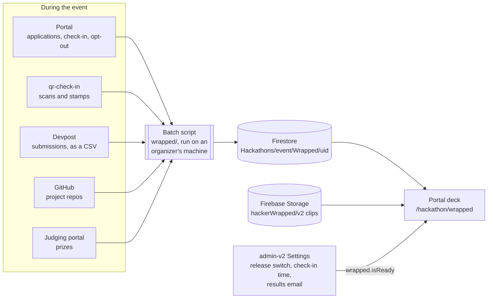
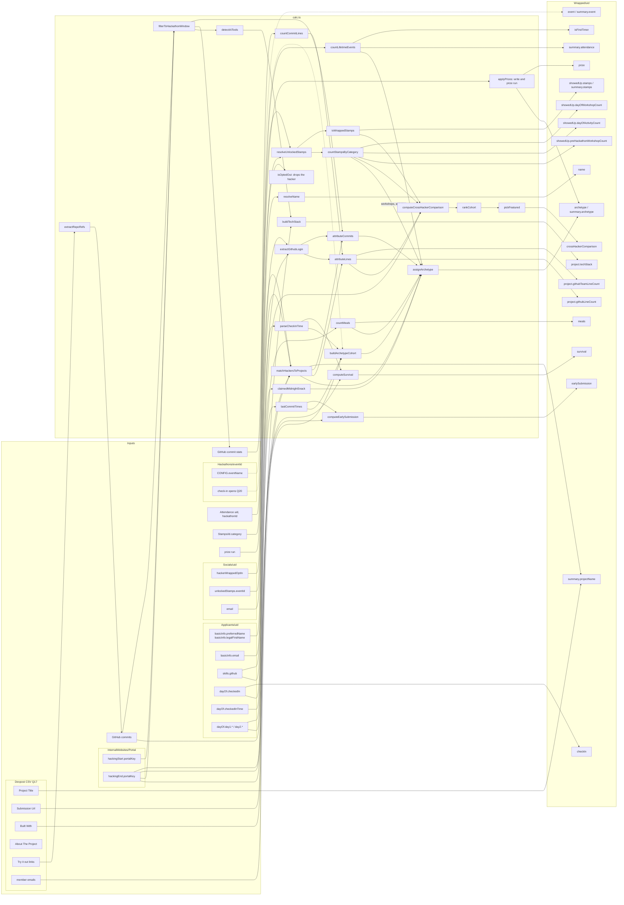

# Hacker Wrapped

A Spotify Wrapped–style story every hacker gets after an nwPlus hackathon. It's a set of
tap-through slides about their weekend: first event or returning, how early they
submitted, their project in one line, lines of code, tech stack, workshops and stamps, how
they compare with everyone else, and any prizes. It ends with an archetype (say, "The
Night Owl") and an image they can share.

Nothing is worked out live. After the event an organizer runs a script that gathers all
the data, calculates each hacker's numbers, and saves one document per hacker. The Portal
reads that document and plays the slides.

## How it fits together



| Part | Where | What it does |
| ---- | ----- | ------------ |
| **Batch script** | `wrapped/` | Reads Firestore, the Devpost CSV, GitHub and the judging portal once, calculates every number and archetype, and writes `Hackathons/{event}/Wrapped/{uid}`. |
| **Deck** | `src/` (route `/{hackathon}/wrapped`) | Reads the hacker's one document and plays the slides. Most slides are a video clip with a text layer filled in with the hacker's numbers; four are built in React. |
| **Clips** | Firebase Storage, `hackerWrapped/v2/` | The slides' background videos, compressed for phones. They're too heavy for git and Hosting. |
| **Admin controls** | admin-v2, Settings | The release switch (`Hackathons/{event}.wrapped.isReady`), the optional check-in opening time, and the results email. |

**Who gets a deck:** accepted hackers who checked in at the event and didn't opt out
(the Wrapped switch on their Portal profile). They see it once it's released, through a
sidebar link and a banner on the dashboard. Organizers (admins) can open any deck before
release.

## Event checklist

**Before the event**

- [ ] The clips are in the prod bucket under the folder `scenes.ts` points at (`CLIPS`),
      and both projects' Storage rules allow public reads of `hackerWrapped/`. See
      [Clips](#clips).
- [ ] `InternalWebsites/Portal.hackingStart` and `.hackingEnd` are set for the event. The
      end is the submission deadline.
- [ ] Every `Stamps` doc for the event has a `category`. The stamps slide fits 20
      stamps; past that it drops uncollected ones from the end of the book.
- [ ] qr-check-in's `DB_HACKATHON` is the event's `Hackathons/` doc id (e.g.
      `HackCamp2026`), so its stamps count.
- [ ] admin-v2's Wrapped settings are deployed to prod. If they aren't, set
      `Hackathons/{event}.wrapped.isReady` by hand.
- [ ] Optional: set the check-in opening time in admin-v2, for The Early Bird. Without
      it, the first check-in is used.

**After hacking ends**

1. Save the Devpost export to `wrapped/csv/` and fill in `CONFIG` at the top of
   `wrapped/script.ts`: event id, name, `portalKey`, `env: "prod"`, CSV path.
2. Dry run with `writeToFirestore: false`: `pnpm wrapped write`. Review the match report
   when it pauses, then `output/docs.json`.
3. Set `writeToFirestore: true` and run `pnpm wrapped write` again. It picks up at the
   write stage.
4. Open `/{hackathon}/wrapped` as an admin to preview your own deck. Admins skip the
   release switch.
5. Release: turn on the Wrapped switch in admin-v2. The sidebar link and banner appear
   for every hacker with a deck.
6. Send the results email from admin-v2. Its links only work while
   `InternalWebsites/Portal.portalLive[hackathon]` is on.
7. After judging, run `pnpm wrapped prize`. It adds prizes and The Prizewinner to the
   winners' decks.
8. A while later, run `pnpm wrapped stats` for the open, completion and share rates.

## Where things live

| Thing | File |
| ----- | ---- |
| Which slides a hacker sees, in order | `src/lib/wrapped/slides.ts` |
| Each slide's clip, text layer and the values that fill it | `src/lib/wrapped/scenes.ts` |
| The deck (timing, preloading, navigation) | `src/components/features/wrapped/wrapped-deck.tsx` |
| The React-built slides (intro, stamps, archetype, summary) | `src/components/features/wrapped/*-slide.tsx` |
| Route, release gate, opt-out check | `src/routes/$activeHackathon/_auth/(account)/wrapped.tsx` |
| Sidebar link and banner gate | `src/hooks/use-wrapped-ready.ts`, `src/lib/stores/wrapped-store.ts` |
| The document's shape | `src/lib/firebase/types/wrapped.ts` |
| Archetype thresholds (shared by the script and the deck) | `src/lib/wrapped/archetype-rules.ts` |
| Script: config, sources, calculations, stages | `wrapped/script.ts`, `sources.ts`, `calc.ts`, `write.ts` |
| Clip compression | `wrapped/compress-clips.ts` (`pnpm wrapped:compress`) |

---

Everything below is reference detail: first the deck, then the script.

## The deck

### Route and access

The deck is `/{hackathon}/wrapped`, signed-in only. It also inherits the
`$activeHackathon` guard, so it needs `InternalWebsites/Portal.portalLive[hackathon]` on.

- **Before load:** the release switch, `Hackathons/{event}.wrapped.isReady`, must be
  `true`. Admins skip this check, and so do dev builds with `?mock=`.
- **Loader:** reads `Hackathons/{event}/Wrapped/{uid}`, the hacker's opt-in
  (`Socials/{uid}.hackerWrappedOptIn`) and the event's `Stamps`, all in parallel. No
  document, or opted out, gives a 404. A hacker who opts out after the script ran still
  has a document, so the deck checks the opt-in itself.
- **Sidebar link and banner:** both use `useWrappedAvailable()`. It's true when the
  event is released, the hacker has a document, and they haven't opted out. They share a
  live listener on the release switch, so an open tab picks up a change without a reload.
  The document and opt-in result is cached for the session in `wrapped-store` and cleared
  when the profile is saved, so an opt-in change shows straight away.
  - The banner can also be dismissed. That's remembered per browser in localStorage,
    per event, and opening the deck dismisses it too.

### Slides

`buildSlides()` in `slides.ts` decides the order, from the document alone:

| Slide | Shown when |
| ----- | ---------- |
| `intro` | always |
| `firstTimer` or `returning` | one or the other, by `isFirstTimer` |
| `earlySubmission` | the project's last commit was more than an hour before the deadline |
| `hackerOrigin` | always |
| `github` | the project has a readable repo. The hacker's own line count is left off when it's null or 0 |
| `techStack` | the project lists at least one tool |
| `attendance` | at least one pre-hackathon or day-of workshop |
| `stamps` | at least one stamp collected |
| `comparison` | the script picked a featured stat. It goes right after that stat's own slide: `github`, `stamps` or `attendance` |
| `prizes` | won a prize |
| `archetype`, `summary` | always |

Each slide's progress bar fills over 10 seconds, and then the slide holds; nothing
advances on its own. Tapping the right half goes forward, and the left half restarts the
slide (or goes back, if tapped early). The arrow keys work too.

### Video slides and coded slides

- **Video slides** (`video-slide.tsx`) are an mp4 plus an optional After Effects text
  layer, exported as Lottie JSON in `public/assets/wrapped/`. `scenes.ts` maps the comp's
  layer names to the hacker's values.
  - The video is the clock. Each frame, the text layer is moved to the video's
    `currentTime`, so the two stay in step through buffering.
  - Clips play muted and inline. iOS won't buffer a paused clip, so hidden neighbours
    are played for a moment and parked to start loading.
- **Coded slides** (intro, stamps, archetype, summary) are React, laid out on a fixed
  1080×1920 canvas (`CompCanvas`) and scaled to cover the screen the same way the videos
  do.
- **Loading:** the deck mounts the next slides hidden so they load ahead. A slide waits
  for its clip, text layer, fonts and images before it starts, up to 5 seconds, then
  starts anyway. A spinner shows if the wait passes 400 ms.

### Clips

The deck loads each clip from Firebase Storage, from the bucket the build is configured
for (`VITE_FIREBASE_STORAGE_BUCKET`):

| | Bucket | Path |
| - | ------ | ---- |
| dev | `nwplus-ubc-dev.appspot.com` | `hackerWrapped/v2/{same path as under public/assets/wrapped}` |
| prod | `nwplus-ubc.appspot.com` | same |

Both projects' Storage rules carry this block. Admins can still upload through the
admin-only catch-all rule.

```
match /hackerWrapped/{path=**} {
  allow read: if true;
  allow write: if false;
}
```

Objects are uploaded as `video/mp4` with `Cache-Control: public, max-age=31536000,
immutable`. Browsers keep them for a year, so **never overwrite a clip**: put a new
encode in a new folder and point `CLIPS` in `scenes.ts` at it.

To re-encode and upload:

```sh
pnpm wrapped:compress --crf 24 --fps 30 --no-ssim --out public/assets/wrapped/compressed
gcloud storage cp -r public/assets/wrapped/compressed/crf-24-30fps/* \
  gs://<bucket>/hackerWrapped/v3/ \
  --content-type=video/mp4 --cache-control="public, max-age=31536000, immutable"
```

Then set `CLIPS = "hackerWrapped/v3"`. Upload to both buckets, and check a clip's public
URL returns `206` for a range request. `pnpm wrapped:compress` without `--out` writes a
side-by-side `compare.html` for judging quality. CRF 24 at 30 fps is the setting in use:
about 23 MB for all 11 clips, and 30 fps halves the decoding work on phones.

Source renders stay in `public/assets/wrapped/` locally but are gitignored, so a fresh clone
needs them copied in before it can re-encode.

The GitHub clip has no text: all the copy is in its comp, so `scenes.ts` can blank the "You
committed" lines for hackers with no `githubLineCount`. Compress and upload it on its own with
`--only github`:

```sh
pnpm wrapped:compress --only github --crf 24 --fps 30 --no-ssim --out public/assets/wrapped/compressed
gcloud storage cp public/assets/wrapped/compressed/crf-24-30fps/github/github-metrics-bg.mp4 \
  gs://<bucket>/hackerWrapped/v2/github/github-metrics-bg.mp4 \
  --content-type=video/mp4 --cache-control="public, max-age=31536000, immutable"
```

The original mp4s under `public/assets/wrapped/` are only the source for compression.
The deck never loads them.

### Keeping it light on phones

iPhones kill the tab ("A problem repeatedly occurred") when the page spends too long
repainting on the CPU. Blend modes (`mix-blend-*`) and masks on layers that animate are
the main cause, because WebKit repaints them every frame. So:

- The intro's glow and noise, the archetype window's asteroid belts and sparks, and The
  Regular's icon are pre-blended into flat WebP images. If the design changes, render the
  layers again and flatten them; don't bring the blend modes back.
- Keep animation to `transform` and `opacity`.
- Two blended spots remain, untested on older iPhones: the stamps slide's soft-light spot
  and the banner launch's gradient mask.

### Telemetry and sharing

- The deck merges `opened`, `completed` and `shareClicked` into
  `Hackathons/{event}/WrappedStats/{uid}`. A missing document means "never opened".
  `pnpm wrapped stats` rolls them up into `WrappedStats/Summary`. Mock decks write
  nothing.
- Only hackers with a deck count, since a session outlives a deck removed by a later run.
  The open rate is a share of decks generated, the completion rate a share of those who
  opened, and the share rate a share of those who completed.
- The summary's share sheet renders the share card to a 1080×1920 PNG in the browser,
  with html-to-image. Nothing is uploaded.

### Developing

- `?mock=<name>` opens a fixture deck in dev builds, with no Firestore needed: `full`,
  `no-project`, `first-timer`, `no-github`, `long-names`, `comparison-stamps`,
  `comparison-events`, `no-comparison`, `minimal` (`src/lib/wrapped/fixture.ts`).
- `VITE_FORCE_WRAPPED_BANNER=true` shows the banner regardless of release, deck or
  dismissal, and launches into the `full` mock.
- `pnpm test` runs the unit tests, including `tests/wrapped-*.test.cjs`.

## The batch script

The script builds one `Hackathons/{eventId}/Wrapped/{uid}` doc per attending, opted-in
hacker, from Firestore, the Devpost CSV export and GitHub.

> Anything marked **Q*n*** is an open question (listed in [Open questions](#open-questions))
> and is also marked `TODO(Qn)` in the code. Settled answers are under
> [Decisions](#decisions).

## Running

```sh
pnpm wrapped write                  # resume where the last run stopped
pnpm wrapped write --from enrich    # redo enrich and every stage after it
pnpm wrapped write --from write     # rewrite every doc from the last assemble
pnpm wrapped prize | stats | delete
```

Set these at the top of `script.ts` before each run:

| Field              | Meaning                                                         |
| ------------------ | --------------------------------------------------------------- |
| `eventId`          | Doc id under `Hackathons/`, e.g. `hackcamp2026`                 |
| `portalKey`        | `hackcamp`, `nwhacks` or `cmd-f`: key into `InternalWebsites/Portal.hackingStart` / `.hackingEnd` |
| `env`              | `dev` or `prod`; picks the service-account credential           |
| `writeToFirestore` | Off: the run stops after writing `output/docs.json` locally     |
| `bypassCache`      | On: re-fetch every source instead of reading `raw/`             |
| `devpostCsvPath`   | Path to the Devpost export                                      |
| `hackingWindow`    | Overrides the Portal's hacking start and end (ISO); `null` uses the Portal |

`.env`: `FIREBASE_SERVICE_ACCOUNT`, `DEV_FIREBASE_SERVICE_ACCOUNT` (JSON inline or a file
path), `GITHUB_PAT`; for `prize`, `VITE_PUBLIC_SUPABASE_URL` and `SUPABASE_SECRET_KEY`.

## Modes

| Mode     | Does                                                                  |
| -------- | --------------------------------------------------------------------- |
| `write`  | The five stages below                                                 |
| `prize`  | Adds `prize` to existing docs after judging; see [Prize run](#prize-run) |
| `stats`  | Organizer statistics: WrappedStats/{uid} -> WrappedStats/Summary      |
| `delete` | Deletes `Hackathons/{eventId}/Wrapped/*` after a typed confirmation; with `writeToFirestore` off it only counts them |

## Write run

```
fetch ──> match ──> enrich ──> assemble ──> write
          ▲         ▲          ▲
          └─────────┴──────────┴── checkpoints (--from)
```

| # | Stage      | Reads                        | Produces                                  | UI                                   |
| - | ---------- | ---------------------------- | ----------------------------------------- | ------------------------------------ |
| 1 | `fetch`    | Firestore, Devpost CSV       | `Hacker[]` (opted-out dropped), rows, event | bar per source; "x hackers recorded" |
| 2 | `match`    | stage 1, `overrides.json`    | `Project[]`, uid → project                | report, then **pauses** for review   |
| 3 | `enrich`   | stages 1–2, GitHub           | per-project commit and line counts, AI tools | bar per project, rate-limit check, bar per commit |
| 4 | `assemble` | stages 1–3                   | `WrappedDoc` per hacker                   | null count per field, featured split |
| 5 | `write`    | stage 4                      | Firestore docs                            | bar per batch; confirm on prod       |

### Per-item loops and cohort-wide steps

Anything that compares hackers to each other runs once over the whole cohort, never
inside a loop.

| Stage      | Per item                                                                                   | Cohort-wide (once)                                                     |
| ---------- | ------------------------------------------------------------------------------------------ | ---------------------------------------------------------------------- |
| `fetch`    | `buildHacker` per applicant                                                                | the Attendance scan (one query, then lookups); the opt-out filter      |
| `match`    | none                                                                                       | `matchHackersToProjects` over every row and hacker                     |
| `enrich`   | per project: fetch commits, window filter. Per commit: fetch stats, `countCommitLines`. Per project: `attributeCommits`, `attributeLines`, `detectAiTools` | between the loops: one rate-limit check |
| `assemble` | per hacker: `assignArchetype`, `buildWrappedDoc`                                           | before the loop: `buildArchetypeCohort`, then `computeCrossHackerComparison` (`rankCohort` over three cohorts) |

### Checkpoints

Resume points, and why each one is at a boundary worth stopping on:

1. **`match`**: every Firestore read and the CSV parse are done. Redo from here after
   editing `overrides.json` or changing matching rules. No network.
2. **`enrich`**: matching has been reviewed and accepted. Redo from here after changing
   commit attribution, line counting (`LINE_COUNT_EXCLUSIONS`), the window or AI
   detection. Commit lists are cached per repo and commit stats per sha, so this redoes
   the work without re-fetching. Commits are fetched for the hacking period plus an hour after it
   (`LATE_PUSH_GRACE_MS`), and the cache path includes that window, so a corrected
   window fetches the lists again.
3. **`assemble`**: every per-project value exists. Redo from here after changing a
   formula, the archetype rules, the comparison's threshold, cohorts or priority, or the
   output schema. Takes seconds.

`write` resumes by itself: `progress.json` records the uids already committed.
`--from write` clears that list to rewrite every doc. `--from fetch` reruns everything
but still reads `raw/` unless `bypassCache` is on.

`stages/fetch.json`, `stages/enrich.json` and `stages/assemble.json` carry
`schemaVersion` (`STAGE_SCHEMA_VERSION` in `types.ts`; absent means 1). Bump it when any
of those shapes changes. `assemble` refuses an older fetch ("run --from fetch") or enrich
("run --from enrich"), and `write` refuses an older assemble ("run --from assemble") even
on a plain resume, which would otherwise push old-shape docs.

### Failure recovery

- **Attendance from stamps (schema 3):** rerun `--from fetch` with `bypassCache` on (or
  delete `raw/stamps.json`): a `stamps.json` cached before `category` was read gives every
  hacker 0 workshops and activities. fetch warns when no stamp has a category.
- **Commit window (schema 5):** rerun `--from fetch`. Commit lists are fetched again into
  `raw/github-window/` (one request per 100 commits); per-commit stats stay cached.
- **Lines committed (schema 2):** rerun `--from enrich`. Only the per-commit stats are
  new requests, one per in-window commit (about 1,340 for cmd-f2026).
- **Before the stats loop**, enrich compares the uncached count with `GET /rate_limit`
  and, if it's short, asks to continue or abort.
- **Interrupted enrich** (Ctrl-C, crash): loses at most the 6 requests in flight. Stats
  are cached per sha and kept with `bypassCache` on, so the rerun picks up where it
  stopped.
- **Rate limit mid-run:** the run stops with the reset time. Rerun after the reset; it
  resumes from the cache.

### Progress file

`cache/{env}/{eventId}/progress.json`, written at every stage change and (throttled)
during a stage's progress bar:

```json
{
  "eventId": "hackcamp2026",
  "env": "dev",
  "updatedAt": "2026-09-28T19:02:11.000Z",
  "stages": {
    "fetch":    { "status": "done", "startedAt": "…", "finishedAt": "…" },
    "match":    { "status": "done", "startedAt": "…", "finishedAt": "…" },
    "enrich":   { "status": "running", "done": 41, "total": 120 },
    "assemble": { "status": "pending" },
    "write":    { "status": "pending" }
  },
  "writtenUids": []
}
```

With no `--from`, a run starts at the first stage not marked `done`. `--from X` resets X,
every later stage and the ledger to `pending` first. With `writeToFirestore` off, `write`
is marked `skipped`, so turning it on and rerunning goes straight to `write`.

### Cache layout

Keyed by env as well as event, so a dev run never reuses prod data.

```
cache/{env}/{eventId}/
  raw/
    event-portal.json  applicants.json  socials.json  attendance.json  stamps.json
    awards.json                      prize run: judging-portal award placements
    github-window/{since}_{until}/{owner}__{repo}.json
                                     one per repo and window; null if private or missing
    github-commits/{sha}.json        one per counted commit: parents and per-file additions;
                                     null if unreadable; kept with bypassCache (a sha never changes)
  stages/{fetch,match,enrich,assemble}.json
  overrides.json                     hand-written match fixes; never overwritten
  match-report.json
  output/docs.json  output/prizes.json  output/stats.json
  progress.json
```

`raw/socials.json` holds opt-in flags, so a hacker who opts out after the first fetch is
only picked up with `bypassCache` on.

### Opt-out and no-shows

After `Socials/{uid}` is fetched, hackers with `hackerWrappedOptIn === false` are
dropped, and so are hackers never scanned in at the event (`dayOf.checkedIn` absent or
`false`, `isCheckedIn`). A missing opt-in field or a missing Socials doc means included.
If nobody is checked in, fetch stops rather than let `write` delete every existing deck
as stale. Excluded hackers get no doc, aren't in any cohort figure, and have their emails kept only so the match report
doesn't list them as unmatched. Their commits and lines still count toward their team's
total. Because they leave every cohort, an opt-out also moves other hackers'
`crossHackerComparison` percentiles (and possibly their `featured` stat), not only their
own doc, so picking one up means rewriting every doc, not just deleting theirs. A no-show
who is still listed on a Devpost row keeps counting toward that row's `teamSize`.

### Match review pause

`match` prints the report and waits:

- **c**: accept and continue
- **r**: re-read `overrides.json` and match again
- **a**: abort (progress stays at `match`)

The report lists: matched hackers, hackers with no project, rows no one matched,
unmatched emails on matched rows, and hackers found on more than one row. The terminal
shows the first 10 of each list; `match-report.json` has all of them. Override entries
naming an unknown uid, email or submission URL are printed as warnings.

`overrides.json`:

```json
{
  "emailToUid": { "alt.email@gmail.com": "<uid>" },
  "uidToProject": { "<uid>": "<submission url>", "<uid2>": null }
}
```

### Nugget (removed)

The AI one-liner slide was dropped after HackCamp 2026's messages weren't good enough to
ship: enrich no longer generates them and the doc has no `project.nugget`. Its design is in
[NUGGET.md](NUGGET.md); the prompt and validation code is still in `calc.ts` / `sources.ts`.

### Writing

Every doc is fully rewritten (`set` without merge), so fields dropped from the schema
disappear. The one exception is `prize`: each batch first reads the existing docs'
`prize` and carries it into the new doc, so re-running `write` after the prize run keeps
prizes.

### Prize run

`prize` reads every `award_placement` for the event from the judging portal (Supabase).
The event is the portal `hackathon` row whose name + year equals `eventId` with
non-alphanumerics dropped, e.g. `{cmd-f, 2026}` for `cmd-f2026`. Awards are joined to
the match stage's projects by Devpost slug (`/software/icarus` and
`/submissions/961463-icarus` both give `icarus`), so the CSV and the portal can use
different URL forms. Every member of a winning project gets `applyPrizes` with the
project's award names.

The run prints the winners and any prizewinning project that matches no CSV row with a
matched hacker (those prizes reach no doc), and writes `output/prizes.json`. With
`writeToFirestore` on, it rewrites each winner's existing doc; winners with no doc are
listed, so run `write` first. Rerunning is safe because `applyPrizes` dedupes. Set
`bypassCache` to pick up awards changed in the portal since the last run.

Every placement the portal records counts as a prize, 4th included (cmd-f2026 has a 4th
place in "Top Three Finalists", "nwChoice Award" and "UBC CS Project Hub").

## Field graph

Source fields on the left, calculation functions (in `calc.ts`) in the middle, doc
fields on the right. Dashed lines mean an unresolved question.



### Field table

| Output field                         | Calculation                                        | Inputs                                                             | Null / default                          |
| ------------------------------------ | -------------------------------------------------- | ------------------------------------------------------------------ | --------------------------------------- |
| `event`, `summary.event`             | none                                               | `CONFIG.eventName`                                                 | none                                    |
| `eventId`                            | none                                               | `CONFIG.eventId`                                                   | none                                    |
| `generatedAt`                        | none                                               | run clock                                                          | none                                    |
| `name`                               | `resolveName`                                      | `basicInfo.preferredName` → `legalFirstName` → `"Hacker"`          | `"Hacker"`                              |
| `isFirstTimer`                       | `countLifetimeEvents`                              | `Attendance` (uid, hackathonId); excludes this event               | `count == 0`                            |
| `summary.attendance`                 | `countLifetimeEvents` + 1                          | `Attendance`; excludes this event                                  | `1`                                     |
| `checkIn`                            | none                                               | `dayOf.checkedIn === true`                                         | `false`                                 |
| `survival`                           | `parseCheckInTime`, `computeSurvival`              | `Portal.hackingEnd` − `dayOf.checkedInTime`                        | null if not checked in                  |
| `earlySubmission`                    | `lastCommitTimes`, `computeEarlySubmission`        | `Portal.hackingEnd` − project's submission time (below)            | null with no project or no commits      |
| `meals`                              | `countMeals`                                         | `dayOf.day1.*`, `dayOf.day2.*`                                     | `0` (**Q18**)                           |
| `showedUp.dayOfWorkshopCount`        | `countStampsByCategory(…, "dayOfWorkshop")`        | unlocked stamps with `Stamps/{id}.category == "dayOfWorkshop"`     | `0`                                     |
| `showedUp.dayOfActivityCount`        | `countStampsByCategory(…, "dayOfActivity")`        | unlocked stamps with `category == "dayOfActivity"`                 | `0`                                     |
| `showedUp.preHackathonWorkshopCount` | `countStampsByCategory(…, "preHackathonWorkshop")` | unlocked stamps with `category == "preHackathonWorkshop"`          | `0`                                     |
| `showedUp.stamps`, `summary.stamps`  | `resolveUnlockedStamps`, `toWrappedStamps`         | `Socials.unlockedStamps[eventId]` (stamp ids) → `Stamps`, any category | `[]`                                |
| `project`                            | `matchHackersToProjects`                           | Devpost emails ↔ applicant / Socials emails                        | null with no project                    |
| `summary.projectName`                | `matchHackersToProjects`                           | Devpost Project Title                                              | null with no project                    |
| `project.techStack`                  | `buildTechStack`, `detectAiTools`                  | Devpost Built With as display names (`tech-names.ts`), at most 4; the first AI tool from co-author trailers / bot authors takes the last slot if none is shown | `[]` |
| `project.githubTeamLineCount`        | `filterToHackathonWindow`, `countCommitLines`, `attributeLines` | Try it out links → additions of commits in [`hackathonStart`, `hackathonEnd`]; bots, merges, excluded files dropped | null with no readable repo |
| `project.githubLineCount`            | `attributeLines`                                   | commit `author.login` = username from `skills.github`              | null if no `skills.github`              |
| `crossHackerComparison.lines` / `.stamps` / `.events` | `computeCrossHackerComparison`, `rankCohort` | every `githubLineCount`; checked-in hackers' stamp count; their day-of workshops + pre-hackathon workshops + day-of activities (**Q10**) | null outside that stat's cohort |
| `crossHackerComparison.featured`     | `pickFeatured`                                     | the three ranked stats and their cohort sizes                      | null: no stat qualifies, slide hidden   |
| `archetype`, `summary.archetype`     | `buildArchetypeCohort`, `assignArchetype`, `applyPrizes` | see [Archetypes](#archetypes)                                | `THE_WARRIOR`                           |
| `prize`                              | `applyPrizes` (prize run)                          | carried over by `write`                                            | absent until the prize run              |

## Archetypes

Rules run in order and the first match wins, so the order is the hierarchy. Output ids
match `ArchetypeId` in `src/lib/firebase/types/wrapped.ts`. The numbers below are
`ARCHETYPE_RULES` in `src/lib/wrapped/archetype-rules.ts`, the one place to change them:
`assignArchetype` and the deck's archetype copy (`src/lib/wrapped/archetype-copy.ts`)
both read it. "Submission time" means the project's `lastCommitAt`: its latest in-window
commit, or a commit (not by a bot) up to an hour after the deadline if there is one. See
[Decisions](#decisions).

| #  | Id                 | Rule                                                                                             | Inputs                                  |
| -- | ------------------ | ------------------------------------------------------------------------------------------------ | --------------------------------------- |
| 1  | `THE_PRIZEWINNER`  | won ≥ 1 prize. Never assigned by `write`; `applyPrizes` upgrades to it                           | prize run                               |
| 2  | `THE_VETERAN`      | attendance count (`countLifetimeEvents` + 1) > 3                                                 | `countLifetimeEvents` + 1               |
| 3  | `ANCHOR`           | team of ≥ 2, strictly the most commits on the team, and ≥ 50% of the team's commits (`teamCommitCount`) | `attributeCommits`                |
| 4  | `THE_LONE_WOLF`    | has a project and `teamSize` is 1                                                                | `Project.teamSize`                      |
| 5  | `THE_SPEEDRUNNER`  | submission time earlier than ≥ 80% of hackers with a submission time                             | `ArchetypeCohort.submissionTimes`       |
| 6  | `THE_EARLY_BIRD`   | checked in ≤ 20 min after check-in opened                                                        | check-in time, **Q20**                  |
| 7  | `THE_FINISHER`     | last in-window commit 0–3 min before `hackathonEnd`; a later fix doesn't cost it                 | `lastInWindowCommitAt`                  |
| 8  | `THE_NIGHT_OWL`    | claimed the midnight snack (`dayOf.day1.snack`)                                                  | `claimedMidnightSnack`                  |
| 9  | `THE_ORIGIN_STORY` | first-timer                                                                                      | `countLifetimeEvents` == 0              |
| 10 | `THE_REGULAR`      | ≥ 1 day-of workshop, ≥ 1 meal and ≥ 1 day-of activity                                            | `countStampsByCategory`, `countMeals`   |
| 11 | `THE_WARRIOR`      | always                                                                                           | none                                    |

A tie for most commits means no one on that team is `ANCHOR`. Only hackers with
`skills.github` can be `ANCHOR`, since their commits are the only ones attributed.
`ANCHOR` and the enrich summary use commit counts, which stay
inside the script (`ProjectEnrichment.teamCommitCount` / `commitsByUid`); the doc carries
lines only.

`write` assigns rules 2–11. The prize run calls `applyPrizes`, which appends the prize
names and sets `archetype` and `summary.archetype` to `THE_PRIZEWINNER`. Because
`write` carries existing prizes over through the same function, re-running `write`
after the prize run never downgrades a winner.

## Decisions

- `earlySubmission` = `hackathonEnd − lastCommitAt`, never negative. Devpost's export has
  no submission time, so the last commit (committer date) stands in for it. A team that
  committed at 7:00 and then again 20 minutes after a 10:00 deadline wasn't early, so
  `lastCommitAt` is the latest commit in the window, unless a commit not by a bot landed
  within `LATE_PUSH_GRACE_MS` (an hour) after the deadline; then it's that one, and
  `earlySubmission` is 0. Commits more than an hour late (a README tidy-up the next day)
  are ignored. Late commits never count toward commits, lines or AI tools.
  `lastInWindowCommitAt` keeps the in-window time for The Finisher. `survival` =
  `hackathonEnd − checkedInAt`. Both are durations.
- GitHub is asked only for commits from `hackathonStart` to `hackathonEnd` plus the
  grace hour (`since` / `until`). A repo that kept going after the event can't push the
  event's commits past the 3,000-commit page cap, and a linked third-party repo
  contributes nothing from outside the event.
- The deadline is `InternalWebsites/Portal.hackingEnd[portalKey]`. The commit window is
  `[hackingStart[portalKey], hackingEnd[portalKey]]`, held as `EventInfo.hackathonStart` /
  `.hackathonEnd`. These are the Portal countdown's times, not `Portal.hackathonStart` /
  `.hackathonEnd`. They are cached in `raw/event-portal.json` and copied into
  `stages/fetch.json`, so a change to them needs that file deleted and `--from fetch`.
- A commit belongs to a hacker when its `author.login` equals the username in
  `Applicants/{uid}.skills.github`. With no `skills.github`, the hacker has no GitHub
  section.
- `project` is nullable. `project.techStack` = Devpost Built With + detected AI tools, stored
  as exported; the slide tidies the names for display (`src/lib/wrapped/tech-stack.ts`).
- `crossHackerComparison.*.count` and every `summary` field copy other fields on
  purpose.
- The GitHub stat is **lines committed**: the sum of `additions` over a commit's files,
  for in-window commits by non-bot authors, attributed by author login like commits.
  Deletions don't count. Excluded paths (case-insensitive, `LINE_COUNT_EXCLUSIONS`):
  lockfiles (`package-lock.json`, `yarn.lock`, `pnpm-lock.yaml`, `bun.lock`, `bun.lockb`,
  `Cargo.lock`, `poetry.lock`, `Gemfile.lock`, `composer.lock`, `go.sum`); any path
  segment `node_modules/`, `vendor/`, `dist/`, `build/`, `.next/`, `venv/`, `.venv/`,
  `__pycache__/`, `.agents/` (installed AI skill packs); `*.min.*`, `*.map`, and data files
  `*.csv` / `*.tsv`. Binary files report 0 additions. Starter-template
  boilerplate counts, and there's no per-commit cap. A commit whose stats GitHub won't
  return (404/409/422/451) adds 0.
- The cross-hacker comparison ranks three stats. **Lines**: hackers with a non-null
  `githubLineCount`. **Stamps**: checked-in hackers, `stamps.length`. **Events**:
  checked-in hackers, `dayOfWorkshopCount + preHackathonWorkshopCount + dayOfActivityCount`.
  A hacker outside a cohort gets `null` for that stat. Every events stamp is also a stamp,
  so a hacker's events count is never above their stamps count.
- Workshop and activity attendance is **stamps collected**, by `Stamps/{id}.category`
  (`preHackathonWorkshop`, `dayOfWorkshop`, `dayOfActivity`, `other`; absent counts as
  `other`). A hacker who attended without unlocking the stamp counts 0, and one stamp
  counts once. The key is `Socials/{uid}.unlockedStamps[eventId]`: the Portal writes
  `dbCollectionName` (the `Hackathons/` doc id, e.g. `HackCamp2026`), and qr-check-in
  writes its `DB_HACKATHON` constant, which must be set to the same id for each event.
  Only stamps with `hackathon == eventId` resolve; fetch warns about unlocked ids that
  match none.
- A stat **qualifies** for the slide with `count ≥ 1`, `topPercentage ≤ 40`
  (`COMPARISON_MAX_TOP_PERCENTAGE`) and a cohort of ≥ 10 (`COMPARISON_MIN_COHORT`). The
  cohort-size guard only affects `featured`; the ranked stat is still written.
- **`featured`** (`pickFeatured`, computed by the script in assemble; the frontend only
  reads it): if lines or stamps qualifies, the one with the lower `topPercentage`, lines
  on a tie; otherwise events if it qualifies; otherwise null. Lines 15%, stamps 10%,
  events 5% gives stamps.
- The comparison slide follows the featured stat's own slide: `lines` after `github`,
  `stamps` after `stamps`, `events` after `attendance`. Percentages show one decimal with
  a trailing `.0` dropped ("Top 0.3%", "Top 12%"). One comp serves all three stats; only
  the copy changes.
- The comparison slide is a video slide like the others
  (`public/assets/wrapped/cross-hacker/`: `cross-hacker-bg.mp4` under `cross-hacker.json`,
  whose green star is `img_0.png`). "Top" and "of" are in the video. `SCENES.comparison`
  in `src/lib/wrapped/scenes.ts` fills the comp's three text layers from
  `crossHackerComparison[featured]`:

  | Layer         | lines                             | stamps                       | events                      |
  | ------------- | --------------------------------- | ---------------------------- | --------------------------- |
  | `.caption`    | You pushed N lines of code.       | You collected N stamps.      | You attended N events.      |
  | `.comparison` | `topPercentage` + "%"             | same                         | same                        |
  | `.category`   | Lines Committed                   | Stamps Collected             | Events Attended             |

  `.caption`'s second line, "You were in the", is fixed, and "line", "stamp" and "event"
  are singular for 1. `.caption` is point text and can't wrap, so a line over about 982px
  shrinks from 70px (Hanken Grotesk 800 averages 0.48em a character); "You pushed 161,959
  lines of code." comes out at 61px. `.category` breaks over two lines.
- Archetypes are assigned before the cross-hacker comparison. `THE_PRIZEWINNER` is
  applied as an upgrade by the prize run. `ANCHOR` is on, and the Finisher window stays
  at 3 minutes.
- `write` fully rewrites docs and carries over only `prize`.
- Opted-out hackers are dropped right after the Socials fetch.

## Open questions

- **Q12 / Q17.** Devpost submission URL format and CSV column names. **Confirmed during
  the event**, see [Devpost export (set during the event)](#devpost-export-set-during-the-event).
### Resolved

- **Q13.** Nugget's project message: implemented as designed in [NUGGET.md](NUGGET.md)
  (Haiku 4.5 via the Batches API, ≤ 80 chars, organizer review pause in enrich, hidden
  when the About text is junk). Run against the real API on 2 dev test projects. Removed
  after HackCamp 2026; see [Nugget (removed)](#nugget-removed).

- **Q6.** `acceptedAndAttending` applicants who checked in (`dayOf.checkedIn === true`)
  only. Reversed from "checked in or not": on cmd-f2026, 42 of 185 attending applicants
  were never scanned in (143 `true`, 2 `false`, 40 absent; the 143 matches `Attendance`),
  the deck thanks the hacker for coming, and admin-v2's Wrapped email queries the same
  `dayOf.checkedIn == true`. See [Opt-out and no-shows](#opt-out-and-no-shows).
- **Q7.** Verified in the `qr-check-in` repo (`src/lib/firebase.ts`):
  `Socials/{uid}.unlockedStamps[eventId]` is an array of **stamp doc ids** from the
  top-level `Stamps` collection, keyed by exactly the `Hackathons/` doc id (e.g.
  `cmd-f2026`), written with `arrayUnion`. Stamp docs carry `name`, `imgURL`,
  `description`, `hackathon`, `isEventUnlockable`, `category`. So fetch adds a
  `Stamps where hackathon == eventId` read, and `resolveUnlockedStamps` maps ids to stamp
  records, dropping ids with no matching stamp.
- **Q9.** Default branch only. Merge commits count as commits but add 0 lines.
- **Q11d.** Checked on dev: `Attendance` docs are flat, one per (hacker, hackathon),
  `{uid, hackathonId, eventYear, recordedAt, sourceVersion, backfillRunId}`, with no
  per-event list. They feed only the lifetime count. Workshop and activity attendance
  came from `Applicants/{uid}.dayOf.events[]` joined to `DayOf`; it now comes from stamp
  categories (see [Decisions](#decisions)).
- **Q14.** A hacker on two submissions gets the later row in the CSV (the export has no
  submission time). Duplicates shouldn't happen, so the match report lists every one
  with the row it picked; `uidToProject` overrides the pick.
- **Q21.** Team stats only: with no `skills.github`, the hacker still gets the team's
  `githubTeamLineCount`, but every individual GitHub field (`githubLineCount`,
  `crossHackerComparison.lines`) is null. Stamps and events are still ranked.

- **Q2.** The display name (`event`, `summary.event`) is `CONFIG.eventName` in
  `script.ts`, e.g. "HackCamp 2026".

- **Q1.** Superseded: pre-hackathon workshop attendance was `preDayOf.events` ∩
  `PreHackathonWorkshops`; it is now unlocked stamps with category
  `preHackathonWorkshop`.
- **Q5.** `Attendance` should not include the current event when the script runs; it
  can on dev, so `countLifetimeEvents` drops this event's id anyway.
  `isFirstTimer = countLifetimeEvents == 0`; `summary.attendance = count + 1`;
  `THE_VETERAN` uses the attendance count: count + 1 > 3.

### Formulas (agreed)

- **Q10.** Each stat's cohort is in [Decisions](#decisions). `topPercentage` =
  `ceil(1000 × (hackers with strictly more + 1) / cohort size) / 10` (`rankCohort`), so
  ties share the better rank, it has one decimal, and the top hacker of 412 gets 0.3. No
  buckets; the frontend picks the wording.
- **Q18.** `meals` = meal slots with at least one scan (max 7), as a single count.
  Repeat scans of one slot count once.
- **Q19.** Durations are written in **hours**, rounded to one decimal
  (`durationHours`). The deck shows `earlySubmission`. `survival` is written but no slide
  reads it.
- **Q20.** admin-v2 writes the check-in opening time to
  `Hackathons/{eventId}.wrapped.checkInOpensAt` (a Timestamp). Without it, Early Bird
  measures from the earliest check-in in the cohort.

## Devpost export (set during the event)

The Devpost column names (Q17) and submission URL format (Q12) can only be confirmed
against a real export, once submissions open. Until then `parseDevpostCsv` and
`extractRepoRefs` are written against guessed names.

**Instructions for an agent running this during the event:**

1. Ask the organizer for the Devpost CSV export and save it to `wrapped/csv/`
   (gitignored). Set `CONFIG.devpostCsvPath` in `script.ts` to that path.
2. Set `CONFIG.eventId` to the `Hackathons/` doc id, and `CONFIG.env` (`dev` first).
3. Read the CSV header row. Update the column-name constants in `sources.ts`
   (`parseDevpostCsv`) to match exactly: project title, submission URL, "Built With",
   "Try it out" links, "About The Project", and the team-member email/name columns.
4. Look at a few submission URLs and update the URL handling in `extractRepoRefs` /
   `Project` to match their real format.
5. Remove the `TODO(Q12)` / `TODO(Q17)` markers, then run
   `pnpm wrapped write` with `writeToFirestore: false` and check the match report
   before anything is written.

## Implementation plan

**Status (2026-11-08):** run on prod for HackCamp 2026 (244 decks). Nugget removed; team
size from the roster answer and Devpost's member count; Devpost's unheaded Team Member 2+
emails read for matching; `*.csv`, `*.tsv` and `.agents/` left out of lines; `techStack`
stored as at most 4 display names with a detected AI tool; `CONFIG.hackingWindow` added
because the Portal's hackcamp times were an hour late.

**Status (2026-11-04):** the commit window is the hacking period plus an hour, late
commits make `earlySubmission` 0, and The Finisher reads `lastInWindowCommitAt`
(schema 5). The clips moved to Firebase Storage (`hackerWrapped/v2`, dev and prod), and
the deck's blended layers were flattened after iPhone crashes. The unused share page,
coded comparison slide and their assets were deleted.

**Status (2026-10-31):** attendance counts read stamp categories (step 11).

**Status (2026-10-26):** lines committed and the three-stat comparison are done
(step 10). Checked against a copy of cmd-f2026's cached prod data with `writeToFirestore` off;
the docs in dev Firestore are still the old shape until the next `write`.

**Status (2026-10-13):** steps 1–9 done, including Nugget. Checked on dev `HackCamp2026`
against a synthetic CSV in `wrapped/csv/`, with enrich run against real public nwplus
repos (window and GitHub logins temporarily edited in the local cache, then restored).
`prize` was checked against the real cmd-f2026 awards with synthetic projects.
Nugget was checked end to end against an in-process mock of the Batches API, then
against the real API on 2 projects. `write` with `writeToFirestore` on was run on dev
(2026-10-13: 7 docs in `nwplus-ubc-dev`, read back identical to `output/docs.json`).
`detectAiTools` found Claude Code and Cursor in `anthropics/claude-code-action`. Not yet
run: `prize` with `writeToFirestore` on. Still TODO: the CSV columns (Q17, at the event).

In a sandbox whose network goes through a proxy, run with `NODE_USE_ENV_PROXY=1` so
Node's `fetch` reaches GitHub.

1. **Skeleton** (done): every function stubbed, flow written as comments in
   `write.ts`.
2. **Plumbing** (done): `infra.ts`: cache, progress file and auto-resume, `--from`, progress
   bars, prompt, Firestore init. Test by running the empty stages end to end.
3. **fetch** (done): the Firestore fetchers, opt-out filter, `buildHacker` and its helpers, and
   CSV parsing against a real header row. Check on dev: counts, and a few hand-checked
   hackers.
4. **match** (done): matching, overrides, the report and the pause.
5. **enrich** (done): GitHub fetch with per-repo cache, the window filter, attribution and
   Nugget with its review pause. `detectAiTools` reads `Co-authored-by:` trailers and AI
   bot authors against `AI_TOOL_SIGNATURES`.
6. **assemble** (done): survival, earlySubmission, archetype cohort and rules, `applyPrizes`,
   cross-hacker comparison, `buildWrappedDoc`, null report. Review `output/docs.json` before any
   write.
7. **write + delete** (done): prize-preserving batched writes with the ledger, prod
   confirmation, delete.
8. **prize + stats** (done): judging-portal prizes joined by Devpost slug; organizer stats.
9. **Cleanup** (done): the old script is removed and this folder moved up to `wrapped/`.
10. **Lines committed + comparison** (done): per-commit stats (`fetchCommitDetail`, cached
    per sha), `countCommitLines`, `attributeLines`, `rankCohort`, `pickFeatured`, stage
    `schemaVersion` guards, and the frontend's comparison slide. The coded slide was
    later replaced by the cross-hacker video and Lottie comp, and the coded version was
    deleted.
11. **Attendance from stamps** (done, 2026-10-31): `DayOf`, `PreHackathonWorkshops`,
    `dayOf.events` and `preDayOf` are no longer read; the three counts come from
    `Stamps/{id}.category`, and the doc gains `showedUp.dayOfActivityCount` (schema 3).
    Checked on synthetic stamps; not yet run against stamps that carry a category.
12. **Commit window and late commits** (done, 2026-11-04): `fetchRepoCommits` sends
    `since`/`until`; `lastCommitTimes` gives `lastCommitAt` and `lastInWindowCommitAt`
    (schema 5). Tested in `tests/wrapped-commit-times.test.cjs`; not yet run against a
    real event.
